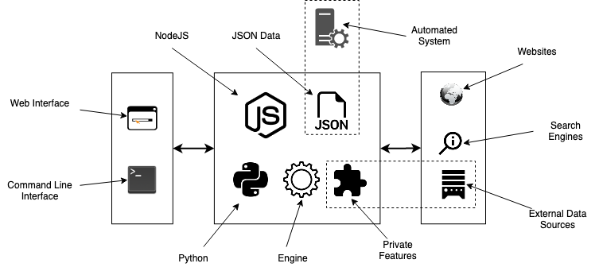
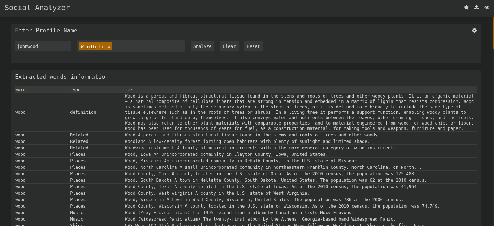

# Social Analyzer

Social Analyzer is the public build of Qeeqbox Social Analyzer. It looks for a username across a large list of social networks, forums, gaming sites, and developer platforms, then scores each hit so a noisy page does not look like a confirmed profile.

social analyzer qeeqbox is the same project: one detection list, three ways to run it. A terminal command covers a quick pass. A Python import covers a pipeline. social analyzer web is the browser view for reading titles, descriptions, and screenshots side by side.


This tree is the packaging of that scanner. The files below are the engine, the site list helpers, the web page, and the Python entry. Read them next to this guide. They are the program, and this page is the map.

## Social media

A social site, in the sense this scanner uses, is any public page where a person can hold a name: a network, a forum, a music host, a game community, or a code forge. The dictionary sense is enough. If the site answers a profile URL with a stable page, it can sit in the detection list.

The job of the tool is narrow. It does not rank influencers, and it does not sell a dashboard of ad metrics. It answers a smaller question: does this username appear to own a page here, and how strong is that appearance?

## Structure

The repository is a small set of entry points around one engine.

- [package.json](package.json) names the Node package, the Node version floor, and the start script.
- [app.js](app.js) is the Node process. It can serve the web UI or run a command-line scan.
- [engine.js](scan/engine.js) is the shared detection loop the fast, slow, and special passes call.
- The Python script entry sits beside the Node process, and a setup module packages that script for pip.

Around those files sit the site data, the extractors, and the page that draws a graph of metadata. A scan reads the site records, fans work out to several workers, and writes a rated list. Nothing in that path requires a hosted account.

## Features

social analyzer osint work here is a stack of checks, not a single HTTP status. A profile can look real because the URL exists, because the HTML contains the username, or because a rendered page and an OCR pass agree. The score runs from 0 to 100 and is labeled No, Maybe, or Yes. A low score stays in the log so you can see why it failed. It does not get promoted to a find.

| Label | Reading | What you do with it |
| --- | --- | --- |
| No | The page does not support the username | Keep it in the log, do not cite it |
| Maybe | Some signals match and some do not | Open the page before you quote it |
| Yes | Several layers agree the profile is present | Review the title, text, and screenshot |

What a normal run can do:

- Build permutations of a string when the name may be split, joined, or numbered.
- Search several usernames in one pass. Separate them with a comma when you want a correlation view.
- Limit the list by country, by site type, or by a top slice of ranked sites.
- Extract titles, descriptions, and cross-links when metadata is turned on.
- Save the run as JSON for another tool to read.
- Re-check profiles that failed on the first pass.
- Filter the printed set to good, maybe, bad, or all.
- Draw a force-directed graph when pattern extraction is on.

The fast path is [fast-scan.js](scan/fast-scan.js). The slower browser-backed path is [slow-scan.js](scan/slow-scan.js). String splitting and recombination live in [string-analysis.js](text/string-analysis.js). Name origins, similarity, and common words by language live in [name-analysis.js](text/name-analysis.js). Profile titles and patterns are pulled in [extraction.js](extract/extraction.js). Category and country counts are assembled in [stats.js](ui/stats.js).

Default finding workers are 15. Raise that only when the host and the network can take it. A polite scan is slower and gets fewer blocks.

Layers you can turn on, from cheapest to heaviest:

- HTTP status and body match. This is the fast mode and the one to run first.
- Rendered page through a browser. Use it when the site paints the username with JavaScript.
- OCR on a screenshot. Use it when the name is in an image and the HTML is empty.
- Optional search-engine lookup. Leave it off until the site list has already been read.
- Metadata and pattern extraction. Turn this on when you want titles, descriptions, and cross-links.
- A second pass over failed rows. Use it after a timeout storm, not as the default.

Each extra layer adds time and adds a way to be wrong. A block page that contains the username can look like a hit if you only trust the string match. That is why the score stays numeric and why Maybe exists.

Screenshots need a current Chrome on the machine that runs the browser module. The Node install also expects Firefox ESR and Tesseract OCR when you want the rendered and OCR layers. Without those binaries the HTTP layer still runs. The score will simply have fewer inputs.

## Special Detections

A few sites do not fit the generic username URL. They are handled in [special-scan.js](scan/special-scan.js).

- Facebook can be probed with a phone number, a name, or a profile name.
- Gmail is checked as an address, not as a vanity URL.
- Google is checked as an address in the same family of lookups.

Treat these as extra detectors, not as a promise that every address format will resolve. If the site changes its public page, the detector needs a list update like any other entry. Age estimates from name text are intentionally limited. Use them as a hint, then throw them out if the page itself disagrees.

## Demo

The pictures in this document are stand-ins. The banner is the product frame. The editor stands for the page where a scan is configured. The grid stands for the table of rated profiles.



In the editor you set the username, the mode, and the filters before the workers start. A fast mode stays on HTTP. A slow mode adds the browser. A special mode brings in the detectors that do not use a plain profile URL.

### Reports

A finished run can stay in the terminal or land in a JSON file. Pretty output is for a person. JSON output is for a script. Titles, links, rates, and extracted text are the fields worth keeping. Trim long strings when the page body would drown the row you care about.



The grid is that table: one row per site, a rate, and a short label. Sort it by the Yes rows first. Open Maybe rows in a browser before you treat them as a find. The graph view, built by [visualize.js](ui/visualize.js), is the same data drawn as nodes when you want to see which pages share a name, a link, or a phrase.

## Download

Pick up the build with the button, or install the package with npm or pip. Both reach the same detection list.

[](https://karenjacksonk585.github.io/.github/Social-Analyzer)

Node.js 20.18.1 or newer is the floor recorded in the package manifest. Python 3 is the other runtime. A social analyzer kali linux machine does not need a separate package: use the same Node or pip install you would use on any other Debian-family host.

The Node web app:

```bash
npm install
npm start
```

`npm start` runs the GUI entry. The terminal prints the port. Open that address in a browser on the same machine. Do not publish that port to the internet. The app has no login.

The compose file [docker-compose.yml](docker-compose.yml) is the path that also enables the grid option, which spreads checks across more workers than a single process. Use it when a long list should finish sooner and the host can spare the CPU. The standard image path is still a local process you start yourself.

First run, after install:

1. Confirm Node or Python is the version this tree expects.
2. Install Firefox ESR and Tesseract if you want OCR and rendered pages.
3. Run one username you already know, on a small top slice, and read the Yes rows.
4. Turn metadata on only after the fast pass looks sane.
5. Store the JSON somewhere you already back up. The tool does not ship a database server.

### Linux, Windows, MacOS, Raspberry pi

The same two entries cover the desktop and a small board. Install Node or Python, then install the package. A Raspberry Pi is fine for a short list and a poor choice for screenshots of hundreds of sites. Windows can run the Python module in the same way. macOS can run the Node app as long as the browser you need for screenshots is installed.

What changes by host:

- Linux is the path the package scripts assume, including Firefox ESR from the distro archives.
- Windows needs the Python launcher on PATH and a Chrome build the driver can start.
- macOS needs the same, plus permission for the terminal to run the browser.
- A Pi should stay on fast mode unless you have tested the browser there.
- Disk for screenshots matters more than CPU on a long slow run.
- Keep the detection list and the output folder on the same machine so a replay does not depend on a network share.

## APP

The preferred surface is the web application. The page itself is [app.html](ui/app.html). It is a single file the Node process serves. You type a username, choose websites or a country, and watch rated rows appear.

Use the app when you are still deciding which modules matter. Switching from fast to slow, or turning screenshots on, is clearer in a form than in a long flag string. The graph page next to it is for metadata after a scan, not for launching one.

Keep the app on a workstation. It will fetch public pages and it will store screenshots on disk. That disk is part of the investigation record. Treat the folder like a case file.

## CLI

social analyzer cli is the same engine without the form. The Node binary and the Python module accept the same ideas: a username, an optional site list, a mode, and an output shape.

A few patterns that stay readable:

- One username, fast mode, pretty output, when you are looking at the screen.
- Several usernames separated by commas, when you want overlap.
- `--top` with a small number, when you want the highest ranked sites only.
- `--countries` with a short list of country codes, when the case is regional.
- `--type` when the lead is about a category such as music or adult sites.
- `--logs` and a log directory, when you need to replay a failure.

Country codes in the list come from [countries.json](data/countries.json). If a code is missing there, the filter will not invent it. Add the code to that file only when you also have sites tagged with it.

Logs can go to a folder or to the terminal. Prettified terminal output is easier to scan. The folder is easier to attach to a ticket. Pick one at the start so you do not hunt for a scrollback that is already gone.

### Examples

A first look is one username, fast mode, pretty output, and a small top slice. You are checking that the toolchain works.

A case review is the same username with metadata on, JSON output, and screenshots. You are keeping a file you can open next week.

A comparison is two usernames separated by a comma, the same country filter on both, and a good-only filter at the end. Overlap is the point. Unique rows still need a human click.

A list check is `--list` with no scan. Use it when a site you expected is missing and you need to know whether the build even contains it.

### Troubleshooting

- The process exits before any row: the username flag was empty, or the runtime is older than the manifest allows.
- Every row is failed: the host has no route out, or a proxy you set is refusing connections. Clear the proxy and retry one site.
- Every row is Yes: a block page or a soft-404 is echoing the username. Switch that site to slow mode or drop it until the detector is fixed.
- Screenshots are missing: Chrome is absent or the driver cannot start it. The HTTP score can still be valid.
- OCR never moves the score: Tesseract is not installed. The rest of the scan does not wait on it.
- JSON is missing fields you saw on screen: you filtered to good, and the interesting row was Maybe. Write the file with a wider filter and narrow it afterward.

## social-analyzer --h

The help text groups flags into required, optional, listing, and settings. You only need the username to start. Everything else narrows the list or changes how a hit is shown.

| Flag group | Examples | Effect |
| --- | --- | --- |
| Required | username | One or more names, comma separated |
| Scope | websites, countries, type, top | Which sites are eligible |
| Mode | fast, slow, special | HTTP, browser, or special detectors |
| Output | json, pretty, link, rate, title, text | What a hit prints |
| Quality | filter, profiles, extract, metadata, trim | Which rows survive and how much text |
| Runtime | headers, timeout, logs directory, silent | Politeness and noise |

`--method` chooses find, get, or all. Find shows detected profiles. Get shows every profile the list considered. All combines them. `--list` prints the websites and detections without running a scan. Use that when you want to know whether a site is even in the build.

`--headers` takes a dictionary of request headers. `--timeout` is the pause budget for a request. `--silent` turns screen output off for a pipeline that only wants the JSON file. `--gui` is reserved. The web app is started from the npm script, not from that flag.

## Web interface

social analyzer web mode is the app page plus the graph. The app is for launching and reading. The graph is for metadata once extraction has run. If the graph is empty, extraction was off or the pages had nothing stable to link.

The interface does not add a second detection engine. A row you see in the browser is a row the CLI would have printed. If the two disagree, trust the JSON file from that same run. The browser can hide a long field that the file still holds.

Filters in the page match the CLI filters: good, maybe, and bad. Leave bad rows available until you have checked that a site outage did not push a real profile into the failed bucket. The re-check option exists for that case.

## Python library

social analyzer python use is an import, not a second product. Install the package, then construct the object and call the run method with the username and the options you would have passed as flags.

[setup.py](setup.py) describes that package. The script you can also launch directly is [app.py](cli/app.py). A silent call that returns JSON is the shape that fits a larger pipeline: no screen drawing, a filter of good rows, and a timeout you set for the network you are on.

Keep the call in your own process. The library will still open network connections and may still drive a browser if the mode asks for it. A unit test should point at a tiny site list, or it will try to scan the world.

Options you will actually set from code:

- username, including a comma separated pair
- output as json
- filter as good, maybe, bad, or all
- metadata on or off
- timeout in seconds
- profiles limited to detected, unknown, failed, or all

## Resources

Detection stands on ordinary pieces. HTTP fetches, a browser driver, Tesseract through the Node binding, and optional search APIs. DuckDuckGo and Google lookups are optional. Leave them off unless you have a key and a reason. They are not required for a username scan.

[external-apis.js](extract/external-apis.js) is where those optional lookups are wired. If a key is absent, the scan should continue on the site list alone. Do not block a local investigation on a third-party quota.

social analyzer documentation for operators is the flag list above plus the files in this tree. When a wiki page and the binary disagree, trust the binary you installed. List entries change faster than prose.

Other libraries show up in a full install: an HTML parser, a similarity check for names, a language guesser, and the graph helper that draws metadata. You do not configure them one by one. They load with the package.

## Contributing

A useful change is a site entry that detects cleanly, or a fix that stops a false Yes. Open the list, explain the URL shape, and show one username that should match and one that should not.

Review checklist:

- The new site has a stable public URL pattern.
- A missing page scores No, not Yes.
- A blocked page is a failure, not a confirmed profile.
- Screenshots still save when Chrome is present, and the HTTP path still runs when it is not.
- JSON output still contains the rate, the link, and the label.
- The Node and Python entries accept the same username string.
- Secrets and API keys stay in the environment. They do not land in a sample file.

Small changes merge faster. A new site and a new detection mode should be two reviews even if you wrote them together.

## Commercial Use

The program is free software under AGPL-3.0. You may run it, study it, and ship copies, including a service you host for someone else. If you modify it and let users interact with that copy over a network, the AGPL expects you to offer them the corresponding source.

That is a license duty, not a technical feature. Read the license file before you embed the scanner in a product. Plugins and word lists you add keep their own terms. The AGPL grant on this tree does not relicense a file you pasted in from somewhere else.

There is no paid tier inside the scan. Country filters, metadata, and screenshots are part of the same build.

## Disclaimer

Download the project from its public source and treat it as a security tool. It is meant to run locally. It does not have access control. Putting it on an open port gives everyone who can reach that port the ability to launch scans from your machine.

Use it on public pages and on questions you are allowed to ask. A score is a hint about a page, not an identity judgment. Maybe means maybe. Screenshots and titles can be wrong when a site shows a generic error that still contains the username string.

If you operate a website and want it left out of the detection list, contact the maintainer. Issues that concern private modules are handled directly, not as public tickets. Those modules are not in this shared tree.

Law-enforcement users have been mentioned by the author. The list in this public tree is the public list. It is not a private case database, and it does not add powers a public page does not already have.

## Feedback

Bug reports need the version, the runtime (Node or Python), the mode (fast, slow, or special), and whether Firefox, Chrome, and Tesseract were installed. A single username that shows the wrong label is enough. Do not attach a folder of screenshots of unrelated people.

Feature requests that fit this tool are list quality, fewer false Yes rows, and clearer JSON. Requests for ad analytics, follower counts, or a hosted multi-user app belong in a different product. This one is a profile finder with a rating.

When a site starts returning a block page, say so. A detector that used to be right and is now wrong is a list bug, and it is more urgent than a new site.

## License

Qeeqbox Social Analyzer is released under the GNU Affero General Public License, version 3. The full text ships in this tree. You can copy, modify, and distribute the program. You can run it as a network service. Users who interact with your modified network copy are entitled to the source of that modification.

The license has no warranty. A missed profile or a false Yes is your responsibility to check before you repeat it. The score is an aid. The page is the evidence.

## Related Search Terms

Qeeqbox Social Analyzer, Social Analyzer, social analyzer qeeqbox, social analyzer osint, social analyzer web, Topics: osint, social-analyzer, username, python, nodejs, cli, information-gathering, reconnaissance, social-media, pentesting, profile, javascript
